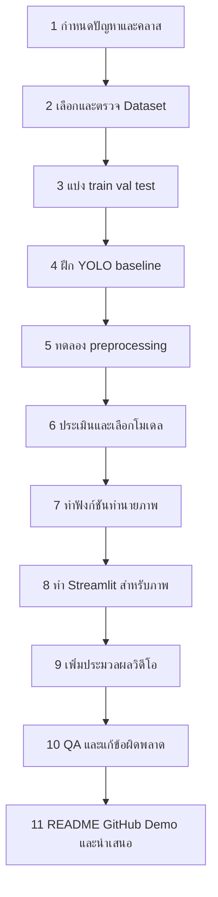

# ลำดับงานตั้งแต่เริ่มจนส่ง

> [!summary] เป้าหมาย
> ทำตามลำดับนี้เพื่อให้ได้ระบบ Smart Helmet Detection ที่ตรวจสอบผลได้และสาธิตได้จริง แต่ละขั้นมีชิ้นงานและเงื่อนไขก่อนส่งต่อให้คนถัดไป

## ขั้นที่ 1 — กำหนดปัญหาและคำตอบที่ต้องการ

**เจ้าของ:** ทุกคน โดยคนที่ 1 ประสานให้ตกลงตรงกัน

กำหนดก่อนว่าแอปจะตอบอะไร เช่น “ตรวจว่าผู้ขับขี่สวมหมวกนิรภัยหรือไม่” ตกลงชื่อคลาสที่ต้องการ เช่น `helmet` และ `no_helmet` แต่ยังไม่ควรยึดชื่อนี้จนกว่าจะตรวจ Dataset จริง

**ชิ้นงาน:** คำอธิบายปัญหา 2–3 ประโยค, ชื่อคลาสที่คาดว่าจะใช้, ขอบเขตภาพ/วิดีโอ

**ผ่านขั้นนี้เมื่อ:** ทุกคนเข้าใจตรงกันว่าระบบต้องตรวจอะไร และข้อมูลแบบใดจึงตอบโจทย์ได้

> [!warning] อย่าสรุปจากการไม่พบหมวกอย่างเดียว
> ถ้า Dataset มีเพียงคลาส `helmet` การไม่พบกล่องหมวกไม่ได้พิสูจน์ว่ามีคนไม่สวมหมวก อาจไม่มีคนอยู่ในภาพหรือโมเดลพลาดได้ ต้องใช้ label `no_helmet` โดยตรง หรือมีวิธีตรวจ person และจับคู่กับ helmet ที่ทีมตรวจสอบแล้ว

## ขั้นที่ 2 — หาและตรวจ Dataset

**เจ้าของ:** คนที่ 2; คนที่ 3 ช่วยตรวจว่า format ใช้ฝึกโมเดลได้

1. หา Dataset จากแหล่งที่อนุญาตให้ใช้ เช่น Roboflow หรือ Kaggle
2. ตรวจ license/เงื่อนไขการใช้และแหล่งที่มา
3. เปิดภาพและ annotation ตัวอย่างจริง ไม่ดูแต่คำอธิบายหน้าเว็บ
4. ตรวจชื่อคลาส จำนวนภาพ และจำนวน label ในแต่ละคลาส
5. ตรวจภาพเสีย, label ว่าง, กล่องผิดตำแหน่ง และ class imbalance
6. จัดรูปแบบข้อมูลและสร้าง config ที่โมเดลอ่านได้

**ชิ้นงาน:** ลิงก์และ license, ตัวอย่างภาพ/label, config เช่น `data.yaml`, ตารางจำนวนภาพและคลาส

**ผ่านขั้นนี้เมื่อ:** คนที่ 3 เปิด Dataset ด้วยเครื่องมือ train ได้และ class names ตรงกับโจทย์

## ขั้นที่ 3 — แบ่งข้อมูลก่อนฝึก

**เจ้าของ:** คนที่ 2

แบ่งข้อมูลเป็น `train`, `validation` และ `test` ก่อนเริ่ม train อย่าให้ภาพเดียวกันหรือภาพจากเหตุการณ์เดียวกันหลุดไปอยู่ทั้ง train และ test ถ้าตรวจพบภาพซ้ำได้ ให้แยกให้อยู่ split เดียวกัน

- `train`: ใช้สอนโมเดล
- `validation`: ใช้ดูผลระหว่างพัฒนาและเปรียบเทียบทางเลือก
- `test`: เก็บไว้ตรวจผลสุดท้าย หลังเลือกโมเดลและการตั้งค่าแล้ว

**ชิ้นงาน:** โฟลเดอร์ split และตารางจำนวนภาพ/จำนวน instance ต่อคลาส

**ผ่านขั้นนี้เมื่อ:** path ถูกต้อง, จำนวนตรงกับของจริง และ test ไม่ถูกนำไป train

## ขั้นที่ 4 — ฝึก baseline model

**เจ้าของ:** คนที่ 3

เริ่มด้วย YOLO11 pretrained แล้ว fine-tune กับ Dataset ของทีม ไม่เริ่มจากศูนย์ บันทึกค่าที่ใช้ เช่น รุ่นโมเดล, epochs, image size, batch size, คำสั่ง train และ log

1. ลอง train รอบสั้นก่อนเพื่อจับปัญหา config/data
2. ทดลองทำนายภาพจาก validation
3. ดูกรอบที่วาดและชื่อ class ว่าตรงกับสิ่งในภาพหรือไม่
4. เก็บ checkpoint ที่ดีที่สุด เช่น `best.pt`

**ชิ้นงาน:** weight, คำสั่งและ config train, ผล validation และตัวอย่าง prediction

**ผ่านขั้นนี้เมื่อ:** โหลด weight แล้วตรวจภาพได้ class ID ตรงกับ class name และมีผลที่มองเห็นเพื่อตัดสินใจ

## ขั้นที่ 5 — ทดลอง Image Processing

**เจ้าของ:** คนที่ 4; ทำร่วมกับคนที่ 3 เพื่อใช้โมเดลและ validation set เดียวกัน

เลือกเทคนิคที่เกี่ยวกับปัญหาจริง เช่น CLAHE เพื่อปรับ contrast ของภาพมืด/contrast ต่ำ อย่าใส่หลายเทคนิคพร้อมกันจนไม่รู้ว่าอะไรช่วย

1. รัน baseline ด้วยภาพเดิม
2. ประมวลผลภาพด้วยเทคนิคที่เลือก
3. รันโมเดลเดิมกับ validation เดิม
4. เปรียบเทียบผลและตัวอย่างภาพ
5. เลือกใช้ preprocessing เป็นค่าเริ่มต้นเฉพาะเมื่อได้ผลหรือมีเหตุผลชัดเจน

**ชิ้นงาน:** `preprocessing.py`, ตัวอย่างก่อน/หลัง, ตารางเปรียบเทียบและข้อสรุป

**ผ่านขั้นนี้เมื่อ:** ทีมบอกได้ว่าใช้เทคนิคอะไร ทำเพื่ออะไร และผลเปลี่ยนอย่างไร

## ขั้นที่ 6 — ประเมินและเลือกโมเดล

**เจ้าของ:** คนที่ 4 โดยคนที่ 3 ส่งผล train/checkpoint ให้

วัดผลบน validation เพื่อเลือกโมเดลและ threshold จากนั้นใช้ test set ประเมินรอบสุดท้าย อย่าเลือกโมเดลจากภาพตัวอย่างไม่กี่ภาพอย่างเดียว

รายงาน metric ที่มีจริง เช่น precision, recall, mAP50 หรือ mAP50-95 พร้อมบอกว่าใช้ split ใด และให้ตัวอย่าง false positive/false negative อย่างน้อยบางกรณี

**ชิ้นงาน:** `results/metrics.md` หรือรายงานที่มี metric, config, split, confusion matrix (ถ้ารองรับ) และตัวอย่างความผิดพลาด

**ผ่านขั้นนี้เมื่อ:** ตัวเลขมาจาก log/ผลรันที่ตรวจย้อนกลับได้ และไม่รายงานผล train ว่าเป็นผล test

## ขั้นที่ 7 — ทำฟังก์ชันทำนายภาพ

**เจ้าของ:** คนที่ 3

ก่อนต่อเข้าเว็บ ให้ทำฟังก์ชันรับภาพหนึ่งภาพแล้วคืนผลมาตรฐาน เพื่อให้แอปและวิดีโอเรียกใช้ซ้ำได้ เช่น

- รายการ detection: class, confidence, bounding box
- ภาพที่วาด bounding box แล้ว
- จำนวน detection แยกตาม class

ตกลงด้วยว่าภาพที่ส่งเข้าเป็น RGB หรือ BGR และฟังก์ชันคืนรูปแบบสีใด

**ชิ้นงาน:** `src/detection.py`, weight ที่แอปหาเจอ และตัวอย่างการเรียกใช้

**ผ่านขั้นนี้เมื่อ:** ทดสอบภาพหนึ่งภาพด้วย Python ได้ผลถูกต้องโดยยังไม่ต้องเปิด Streamlit

## ขั้นที่ 8 — ทำ Streamlit สำหรับภาพก่อน

**เจ้าของ:** คนที่ 1; คนที่ 3/4 ส่งฟังก์ชันให้เรียก

1. ทำ upload ภาพ
2. เพิ่มปุ่ม/ตัวเลือก confidence threshold และ preprocessing ถ้าจำเป็น
3. เรียกฟังก์ชันทำนายภาพ
4. แสดงภาพต้นฉบับและภาพผลลัพธ์
5. แสดง class, confidence และจำนวนที่ตรวจพบ
6. แจ้ง error เมื่อไม่มี weight หรือไฟล์ไม่รองรับ

**ชิ้นงาน:** `app.py` ที่รันได้และตรวจภาพจริงได้ครบเส้นทาง

**ผ่านขั้นนี้เมื่อ:** ผู้ใช้ใหม่อัปโหลดภาพแล้วเข้าใจผลได้ โดยไม่ต้องใช้ mock prediction

## ขั้นที่ 9 — เพิ่มประมวลผลวิดีโอ

**เจ้าของ:** คนที่ 5 ทำเฟรม; คนที่ 1 ทำส่วน UI; คนที่ 3 ให้ฟังก์ชันทำนายหนึ่งเฟรม

วิดีโอเป็นภาพหลายเฟรมเรียงกัน จึงอ่านเฟรมหนึ่ง ส่งเข้าโมเดลหนึ่งครั้ง วาดผล เขียนเฟรมลงวิดีโอผลลัพธ์ แล้ววนทำกับเฟรมถัดไปจนจบ

1. รับคลิปสั้นจาก upload
2. เปิดไฟล์ด้วย OpenCV และอ่าน FPS/ขนาด
3. อ่านเฟรมทีละภาพและแปลงสีให้ตรงกับ model API
4. เรียกฟังก์ชันตรวจภาพของคนที่ 3
5. เขียนภาพที่วาดกรอบแล้วลงไฟล์ output
6. ปิด VideoCapture/VideoWriter แม้เกิด error
7. ให้ Streamlit แสดง progress และเล่น/ดาวน์โหลดคลิปผลลัพธ์

**ชิ้นงาน:** `src/video_processing.py` และวิดีโอผลลัพธ์ที่เปิดเล่นได้

**ผ่านขั้นนี้เมื่อ:** คลิปสั้นทำงานครบ ไม่ค้างเงียบ และแจ้ง error ได้เมื่อไฟล์อ่านไม่ได้

> [!note] จำกัดขอบเขตวิดีโอ
> เริ่มจาก MP4 สั้นและ resolution ไม่สูง ถ้าช้าให้ประมวลผลทุก 2–3 เฟรมหรือย่อภาพ แต่ต้องบอกข้อจำกัดเรื่องความเร็ว/โอกาสพลาดเฟรม การนับ detection ทุกเฟรมไม่ใช่จำนวนคนไม่ซ้ำ ถ้ายังไม่มี tracking

## ขั้นที่ 10 — ทดสอบระบบครบเส้นทาง

**เจ้าของ:** ทุกคนตรวจส่วนของตัวเอง; คนที่ 5 เป็นผู้รวบรวมผล QA

ทดสอบอย่างน้อย:

- ภาพมีหมวก, ไม่มีหมวก (ถ้ามี class นี้), และภาพที่ไม่มีวัตถุเป้าหมาย
- ภาพแสงน้อยหรือวัตถุอยู่ไกล
- ไฟล์ภาพผิดชนิดและ weight หาย
- วิดีโอสั้นที่รองรับและวิดีโออ่านไม่ได้
- เริ่มแอปใหม่จากขั้นตอนใน README

**ชิ้นงาน:** checklist ที่ระบุผ่าน/ไม่ผ่าน, วิธีทำซ้ำบั๊ก และรายการข้อจำกัด

**ผ่านขั้นนี้เมื่อ:** ปัญหาที่ขวาง demo ถูกแก้ หรือมีทางสำรองพร้อมและบันทึกข้อจำกัดไว้

## ขั้นที่ 11 — แพ็กส่งงาน

**เจ้าของ:** คนที่ 5 รวมไฟล์; เจ้าของแต่ละส่วนตรวจความถูกต้องของตัวเอง

- โค้ดแอปและ source code
- `requirements.txt` และ README วิธีติดตั้ง/รัน
- Dataset source/license, จำนวนข้อมูล, class และ split
- weight หรือ URL ดาวน์โหลดที่ทีมเข้าถึงได้
- methodology, algorithm และ metric ที่ตรวจสอบได้
- screenshot, ผลลัพธ์ตัวอย่าง และ demo video
- GitHub repository และสไลด์นำเสนอ

**ผ่านงานเมื่อ:** คนอื่นเปิด repo ทำตาม README แล้วรัน demo ได้ และข้อมูลใน README/สไลด์ตรงกับระบบจริง

## ทำอะไรได้พร้อมกัน

ลำดับด้านบนคือ dependency ของงาน แต่ไม่จำเป็นต้องรอให้คนหนึ่งทำทั้งหมดเสร็จก่อน:

- คนที่ 2 ตรวจ Dataset ขณะที่คนที่ 1 ทำหน้าเว็บเปล่า
- คนที่ 3 เตรียม environment และลอง pretrained model ระหว่างรอ Dataset; เริ่ม fine-tune หลัง config/data ผ่าน
- คนที่ 4 สำรวจคุณภาพภาพก่อน แล้วรัน preprocessing/evaluation เมื่อมี baseline
- คนที่ 5 ทำ video I/O ด้วยคลิปทดสอบสั้นและ callback ชั่วคราวระหว่างรอโมเดล แล้วเปลี่ยนเป็น inference จริงก่อน demo
- คนที่ 5 เริ่ม README ตั้งแต่วันแรก แต่เติม metric/ผลจริงหลังเจ้าของงานส่งข้อมูล

## แผนย่อ 5 วัน

| วัน | จุดหมายหลัก | ต้องจบก่อนเลื่อนไป |
|---|---|---|
| Day 1 | ล็อกปัญหา, class, Dataset, format และ API | ยืนยัน Dataset และ class mapping |
| Day 2 | train baseline, ทำ preprocessing, ทำ UI/video I/O โครง | มี model inference ตัวแรกและ UI ทำงาน |
| Day 3 | เชื่อมภาพ end-to-end และได้ metric รอบแรก | MVP ภาพทำงานและเริ่มซ้อม demo |
| Day 4 | เพิ่มวิดีโอถ้าทัน, แก้บั๊ก, freeze ระบบ | วิธีรัน/ไฟล์นำเสนอพร้อม |
| Day 5 | clean start, QA รอบสุดท้าย, ส่งมอบ | README, GitHub, demo เปิดได้ |

ถ้าวันนำเสนอ **2 พฤศจิกายน 2569** ในโจทย์ยังเป็นกำหนดจริง ให้ freeze MVP ภายใน Day 3 และใช้ Day 4 นำเสนอ/แก้เฉพาะบั๊กที่ขวาง demo

## เริ่มงานตอนนี้

1. เรียกประชุมสั้น ๆ ให้ทุกคนตกลงโจทย์และ class ที่ต้องการ
2. ให้คนที่ 2 หา Dataset 1–2 ตัวเลือกแล้วเปิด annotation ให้ดูภายในวันแรก
3. ให้คนที่ 3 ตรวจว่า Dataset โหลดเข้า YOLO ได้
4. ให้ทีมยืนยัน Dataset และแบ่ง train/validation/test ก่อน train จริง
5. ให้แต่ละคนเริ่มงานขนานตาม [[Smart_Helmet_Detection_แผนงาน_5วัน]]
