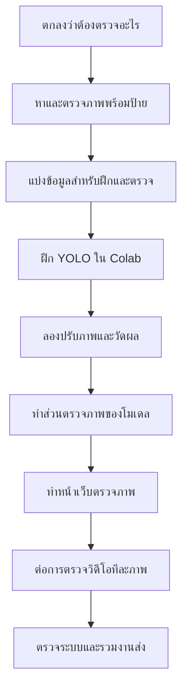

# ลำดับงานตั้งแต่เริ่มจนส่ง

> [!summary] ภาพรวม
> ตกลงโจทย์ → หาและตรวจภาพ → แบ่งข้อมูล → ฝึกโมเดล → ปรับภาพและวัดผล → ทำเว็บ → เพิ่มวิดีโอ → ตรวจและรวบรวมส่งงาน

ถ้าเจอคำที่ไม่คุ้น เปิด [[Obsidian-work/00 - คำศัพท์ง่าย ๆ|คำศัพท์ง่าย ๆ]] ได้

## 1. ตกลงว่าจะให้ระบบตรวจอะไร

**ทุกคนช่วยกันคุยก่อน** คนที่ 1 จดข้อสรุปไว้

เขียนโจทย์ให้ชัด เช่น “หาและระบุคนที่สวมหมวกนิรภัย” หรือ “แยกภาพที่มีหมวกกับไม่มีหมวก” สองโจทย์นี้ต้องใช้ป้ายกำกับในชุดภาพไม่เหมือนกัน

**ตรวจให้แน่ใจ:** ถ้าจะให้ระบบบอก `no_helmet` ชุดภาพต้องมีตัวอย่างและป้ายกำกับสำหรับคนที่ไม่สวมหมวกด้วย การไม่เจอกล่อง `helmet` อย่างเดียวไม่พอจะสรุปว่าไม่มีหมวก

**ได้อะไรเมื่อจบ:** คำอธิบายโจทย์สั้น ๆ และรายชื่อประเภทที่ต้องการให้ระบบแยก

## 2. หาและตรวจชุดภาพ

**คนที่ 2 หาและจัดข้อมูล; คนที่ 3 ช่วยตรวจว่าใช้ฝึกโมเดลได้**

1. เลือกชุดภาพจากแหล่งที่ระบุได้ เช่น Roboflow หรือ Kaggle
2. จดลิงก์ที่มาและเงื่อนไขการใช้งาน
3. เปิดภาพและป้ายกำกับจริงหลาย ๆ ภาพ อย่าดูแค่คำโฆษณาของชุดข้อมูล
4. ตรวจว่าป้ายกำกับตรงกับโจทย์ และมีจำนวนภาพพอในแต่ละประเภท
5. ตรวจภาพเสีย ป้ายผิด และภาพซ้ำ
6. ถ้าชุดภาพยังไม่อยู่ในรูปแบบที่ YOLO ใช้ ให้ส่งออกเป็น YOLO format หรือแปลงก่อนฝึก

**ได้อะไรเมื่อจบ:** ชุดภาพพร้อมใช้, รายชื่อประเภท, จำนวนภาพ และไฟล์ `data.yaml` ที่บอกตำแหน่งภาพกับชื่อประเภท

## 3. แบ่งภาพเป็นชุดฝึกและชุดตรวจ

**คนที่ 2 ทำและส่งให้คนที่ 3**

- **train:** ภาพที่ให้โมเดลเรียนรู้
- **validation:** ภาพที่ใช้ดูผลระหว่างปรับโมเดล
- **test:** ภาพที่เก็บไว้ตรวจผลสุดท้ายหลังเลือกวิธีทำแล้ว

อย่าเอาภาพเดียวกันไปอยู่ทั้งชุดฝึกและชุด test ถ้าเป็นภาพจากคลิปเดียวกัน ควรแยกภาพจากคลิปนั้นไว้กลุ่มเดียวกันเพื่อลดการจำภาพ

**ได้อะไรเมื่อจบ:** โฟลเดอร์หรือรายชื่อไฟล์ของแต่ละชุด และตารางจำนวนภาพต่อประเภท

## 4. ฝึกโมเดลใน Google Colab

**คนที่ 3 ทำตาม [[Obsidian-work/สมาชิก/03 - ฝึกโมเดล|คู่มือฝึกโมเดล]]**

1. รับ Dataset ที่คนที่ 2 ตรวจแล้ว
2. เปิด Colab และเลือกใช้ GPU ถ้ามีให้เลือก
3. นำชุดภาพเข้า Colab โดย upload หรือเปิดจาก Google Drive
4. ติดตั้ง Ultralytics ใน notebook
5. โหลด YOLO11 รุ่นเล็กที่ฝึกไว้ก่อน แล้วสั่ง train ด้วย `data.yaml` ของทีม
6. ตรวจภาพผลลัพธ์และตัวเลขระหว่าง train
7. เก็บไฟล์ `best.pt` และบันทึกผลไว้ใน Drive ก่อนปิด Colab

**ได้อะไรเมื่อจบ:** ไฟล์โมเดลที่ฝึกแล้ว, ตัวอย่างภาพตรวจจับ, คำสั่งฝึก และผลจาก validation

## 5. ปรับภาพและเปรียบเทียบผล

**คนที่ 4 ทำร่วมกับคนที่ 3**

1. เลือกวิธีปรับภาพหนึ่งวิธีที่ช่วยปัญหาจริง เช่น เพิ่มความชัดของภาพมืดด้วย CLAHE
2. ลองใช้วิธีกับภาพชุด validation แล้วดูภาพก่อนและหลัง
3. ให้โมเดลเดียวกันตรวจภาพชุดเดิมทั้งก่อนและหลังปรับ
4. เทียบผลและบันทึกวิธีที่ใช้
5. ถ้าคะแนนแย่ลง ให้รายงานตามจริงและอาจเลือกไม่ใช้วิธีนั้นเป็นค่าเริ่มต้น

**ได้อะไรเมื่อจบ:** ไฟล์ `preprocessing.py`, ภาพตัวอย่างก่อน/หลัง และตารางเปรียบเทียบ

## 6. ตรวจว่าโมเดลทำงานดีแค่ไหน

**คนที่ 4 วัดผล; คนที่ 3 ส่งโมเดลและผล train ให้**

ใช้ validation เพื่อเลือกการตั้งค่า และใช้ test ตรวจผลสุดท้าย รายงานตัวเลขที่โปรแกรมคำนวณได้จริง เช่น precision, recall หรือ mAP พร้อมบอกว่าใช้ภาพชุดใด ดู [[Obsidian-work/00 - คำศัพท์ง่าย ๆ|คำศัพท์ง่าย ๆ]] หากไม่เข้าใจชื่อตัวเลข

ดูภาพที่โมเดลตรวจพลาดด้วย: โมเดลตีกรอบสิ่งที่ไม่มีจริงหรือไม่? พลาดวัตถุที่เห็นชัดหรือไม่? การแสดงตัวอย่างเหล่านี้ช่วยอธิบายข้อจำกัดของระบบ

**ได้อะไรเมื่อจบ:** ตารางผล, ภาพตัวอย่างที่ตรวจถูก/ผิด และคำอธิบายข้อจำกัด

## 7. ทำส่วนทำนายภาพให้คนอื่นเรียกใช้

**คนที่ 3 ทำ; คนที่ 1 และ 5 รับไปต่อ**

ทำฟังก์ชันหนึ่งตัวที่รับภาพแล้วคืนชื่อประเภท คะแนนความมั่นใจ พิกัดกรอบ และภาพที่วาดกรอบแล้ว ต้องใช้ชื่อประเภทตาม Dataset และรูปแบบสีภาพตามที่ทีมตกลงใน [[03 - สัญญาเชื่อมระบบ]]

**ได้อะไรเมื่อจบ:** `src/detection.py`, `best.pt`, วิธีเรียกฟังก์ชัน และตัวอย่างผล

## 8. ทำหน้าเว็บตรวจภาพ

**คนที่ 1 ทำ; คนที่ 3 และ 4 ส่งฟังก์ชันให้เรียก**

1. ทำหน้าเว็บด้วย Streamlit
2. เพิ่มช่องเลือกภาพ
3. เมื่อกดปุ่ม ให้เรียกฟังก์ชันของคนที่ 3
4. แสดงภาพเดิมและภาพที่มีกรอบ
5. แสดงชื่อประเภท คะแนนความมั่นใจ และจำนวนที่พบ
6. แจ้งผู้ใช้หากไฟล์ไม่ใช่ภาพหรือหาโมเดลไม่เจอ

**ได้อะไรเมื่อจบ:** เปิดแอปได้และตรวจภาพจริงได้โดยไม่ใช้ผลจำลอง

## 9. เพิ่มตรวจวิดีโอ

**คนที่ 5 ทำการอ่าน/เขียนวิดีโอ; คนที่ 1 ทำปุ่มและหน้าจอ; คนที่ 3 ให้ฟังก์ชันตรวจหนึ่งภาพ**

วิดีโอเป็นภาพหลายภาพต่อกัน โค้ดอ่านภาพหนึ่งเฟรม ส่งให้โมเดลตรวจ แล้วเขียนภาพที่มีกรอบลงคลิปผลลัพธ์ ทำซ้ำจนคลิปหมด เริ่มจากคลิปสั้นก่อนเพราะการตรวจทุกเฟรมใช้เวลานาน

**ได้อะไรเมื่อจบ:** `src/video_processing.py`, คลิปผลลัพธ์ที่เปิดเล่นได้ และข้อความแสดงความคืบหน้า/ข้อผิดพลาด

## 10. ตรวจและรวบรวมงานส่ง

**ทุกคนตรวจส่วนของตัวเอง; คนที่ 5 รวบรวม README และสื่อสาธิต**

- ลองเปิดแอปจากวิธีที่เขียนไว้ใน README
- ใช้ภาพที่ไม่ได้ใช้ฝึกตรวจโมเดล
- ลองภาพที่มืด/ไกลและไฟล์ผิดชนิด
- ลองวิดีโอสั้นและตรวจว่าไฟล์ผลลัพธ์เปิดได้
- ตรวจให้ชื่อประเภทและตัวเลขในแอป รายงาน และสไลด์ตรงกัน
- รวมโค้ด, วิธีติดตั้ง, วิธีรัน, ที่มาชุดภาพ, ผลประเมิน, ภาพหน้าจอ และวิดีโอสาธิต

## งานที่ทำคู่ขนานกันได้

- คนที่ 1 ทำหน้าตาเว็บเปล่าได้ระหว่างรอโมเดล แต่ยังแสดงผลจำลองอยู่จนโมเดลจริงพร้อม
- คนที่ 3 เตรียม Google Colab และตรวจตัวอย่างข้อมูลได้ระหว่างรอ Dataset; ยังไม่ควรฝึกกับข้อมูลที่ class ไม่ชัด
- คนที่ 4 ดูสภาพแสงและความคมของภาพได้ก่อน แล้วค่อยวัดผลเมื่อมีโมเดล
- คนที่ 5 ลองอ่าน/เขียนวิดีโอสั้นได้ก่อน แล้วค่อยเชื่อมโมเดลจริงเมื่อคนที่ 3 ส่งฟังก์ชัน

## เอกสารช่วยทำ

- [คู่มือ YOLO11 อย่างเป็นทางการ](https://docs.ultralytics.com/models/yolo11)
- [รูปแบบชุดข้อมูลตรวจจับของ YOLO](https://docs.ultralytics.com/datasets/detect)
- [[Obsidian-work/Smart_Helmet_Detection_คู่มือทีม|กลับหน้า Dashboard]]
