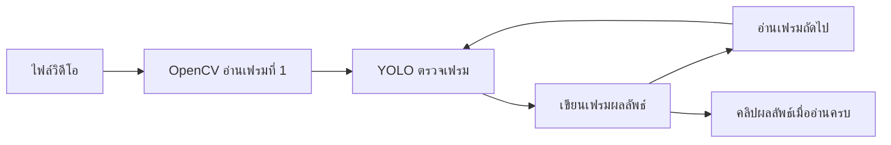

# สัญญาเชื่อมระบบ — Smart Helmet Detection

> [!important] ทำไมต้องมีข้อตกลงนี้
> ทุกคนทำงานขนานกันได้เมื่อชื่อไฟล์, class, รูปแบบสีภาพ และผลลัพธ์ตรงกัน ก่อนเปลี่ยนสัญญาให้แจ้งทีมและแก้ทุกจุดที่เรียกใช้

## โครงไฟล์เสนอแนะ

```text
project/
├── app.py
├── requirements.txt
├── README.md
├── data.yaml
├── weights/
│   └── best.pt
├── src/
│   ├── detection.py
│   ├── preprocessing.py
│   └── video_processing.py
├── results/
│   ├── metrics.md
│   ├── confusion_matrix.png
│   └── examples/
└── demo/
    └── demo.mp4
```

ไฟล์ dataset ขนาดใหญ่ไม่จำเป็นต้อง commit เข้า GitHub ให้ระบุ URL/license และขั้นตอนดาวน์โหลดแทน ส่วน weight หากใหญ่ให้ใช้ลิงก์ที่สมาชิกเข้าถึงได้และบอกตำแหน่งวางไฟล์ คนที่ 5 เป็นเจ้าของ video frame loop; คนที่ 1 เป็นเจ้าของ upload/display ใน Streamlit

## รูปแบบภาพและฟังก์ชัน

- UI อ่านภาพจาก upload แล้วแปลงเป็น **RGB `numpy.ndarray`** ก่อนส่งให้ฟังก์ชันอื่น
- OpenCV operation ที่ต้องใช้ BGR ให้แปลงในฟังก์ชันและคืนเป็น RGB ตาม contract
- Bounding box ใช้พิกัด `[x1, y1, x2, y2]` บนภาพต้นฉบับ
- confidence อยู่ในช่วง 0–1
- class name ใช้ mapping จาก dataset/config แหล่งเดียวกัน

```python
# src/detection.py

def predict_image(image_rgb, weights_path, conf_threshold=0.25):
    """คืน dict ที่มี detections, counts และ annotated_rgb"""

# src/preprocessing.py

def preprocess_image(image_rgb, method="clahe"):
    """คืนภาพ RGB uint8 รูปร่าง HxWx3; ระบุ method='none' ได้"""
```

ตัวอย่าง detection:

```python
{"class_name": "helmet", "confidence": 0.91, "bbox_xyxy": [14, 28, 130, 165]}
```

`helmet` เป็นตัวอย่างเท่านั้น ห้าม copy เป็น class จริงถ้า dataset ใช้ชื่ออื่น

## โครงผลลัพธ์

```python
{
    "detections": [
        {"class_name": "helmet", "confidence": 0.91, "bbox_xyxy": [14, 28, 130, 165]}
    ],
    "counts": {"helmet": 1},
    "annotated_rgb": image_rgb
}
```

ถ้าโมเดลให้เพียง `helmet` และไม่มี `no_helmet` ห้ามนับการไม่พบ helmet เป็น no-helmet โดยอัตโนมัติ เว้นแต่ทีมมีการตรวจจับ person และนิยามวิธีจับคู่ที่ผ่านการตรวจสอบแล้ว

## วิดีโอหนึ่งคลิปกลายเป็นงานตรวจภาพทีละเฟรม

โมเดลตรวจจับรับภาพนิ่งหนึ่งภาพต่อการเรียกหนึ่งครั้ง วิดีโอจึงต้องถูกอ่านเป็นภาพเรียงกัน: อ่านเฟรม → ส่งให้ YOLO → รับภาพที่ใส่กรอบแล้ว → เขียนลงไฟล์วิดีโอผลลัพธ์ → ทำซ้ำจนจบคลิป



นี่คือความหมายของคำว่า **pipeline** ในโน้ตนี้: ลำดับนำเข้า-ประมวลผล-ส่งออก ไม่ใช่โมเดลตัวใหม่ วิดีโอ 10 วินาทีที่ 30 FPS มีราว 300 เฟรม จึงอาจต้องเรียกโมเดลประมาณ 300 ครั้ง ถ้าช้าให้เริ่มจากคลิปสั้นหรือลดความละเอียด/ประมวลผลทุกเฟรมเว้นเฟรม โดยแจ้งข้อจำกัดไว้

## วิดีโอ: API ที่เสนอให้ทีมตกลง

```python
def process_video(video_path, predict_frame, output_path,
                  frame_stride=1, max_frames=None, progress_callback=None):
    """อ่านเฟรม, เรียก predict_frame, เขียน annotated video และคืน metadata"""
```

- `predict_frame(frame_rgb)` เป็นฟังก์ชันของคนที่ 3 ที่ใช้ inference หนึ่งเฟรม
- คนที่ 5 รับผิดชอบ `src/video_processing.py` และ resource cleanup
- คนที่ 1 รับผิดชอบ UI upload, progress display และ playback/download output
- metadata ควรมี `output_path`, `fps`, `width`, `height`, `frames_processed`, `status`
- ห้ามรวม detection จากทุกเฟรมแล้วเรียกว่า “จำนวนคนไม่ซ้ำ” ถ้ายังไม่มี tracking

## การตัดสินใจที่ต้องกรอก

- [ ] Framework/YOLO version:
- [ ] Dataset class names และ class mapping:
- [ ] Weight path หรือ download URL:
- [ ] Input frame rate/ขนาดวิดีโอสูงสุด:
- [ ] Preprocessing default (`none` หรือชื่อวิธี):
- [ ] คนอนุมัติการเปลี่ยน contract:

## ข้อความ handoff

เมื่อส่งงานให้ใส่ข้อความสั้น ๆ ในกลุ่ม: **ไฟล์/ฟังก์ชัน**, **วิธีเรียก**, **ตัวอย่าง input/output**, **ข้อจำกัด/สิ่งที่ยังไม่เสร็จ**


