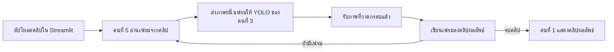

# คนที่ 5 — Video Pipeline, QA และ Demo

> [!abstract] ผลลัพธ์ของบทบาทนี้
> หน้าที่ที่เพิ่มให้คนที่ 5 คือพัฒนาโมดูลประมวลผลวิดีโอ: อ่านคลิปทีละเฟรม → เรียกโมเดล → เขียนคลิปผลลัพธ์ พร้อมดู QA, README และ demo. ตอนนี้เป็นแผนงานและแบบ API ยังไม่ได้สร้างโค้ดโมดูลนี้

## อธิบายแบบง่าย: ทำไมวิดีโอต้องประมวลผลทีละเฟรม

วิดีโอคือภาพนิ่งหลายภาพเรียงต่อกัน โมเดล YOLO รับภาพทีละภาพ ดังนั้นโค้ดจะอ่านภาพจากคลิปทีละเฟรม ส่งแต่ละเฟรมเข้าโมเดล วาดกรอบลงบนภาพ แล้วนำภาพที่ได้มาต่อเป็นคลิปผลลัพธ์ คำว่า **pipeline** ในงานนี้หมายถึงลำดับขั้นตอนเหล่านี้ ไม่ใช่โมเดลหรืออัลกอริทึมใหม่



ตัวอย่างเช่น คลิป 10 วินาทีที่ 30 เฟรมต่อวินาทีมีประมาณ 300 เฟรม โค้ดเรียก YOLO ซ้ำกับภาพ 300 ภาพตามลำดับ แล้วเขียนผลกลับเป็นคลิปเดียว การทำทีละเฟรมช่วยไม่ต้องโหลดทั้งคลิปเข้า RAM พร้อมกัน แต่ถ้าโมเดลประมวลผลช้า คลิปก็จะใช้เวลานาน จึงเริ่มทดสอบด้วยคลิปสั้นก่อน

**แบ่งหน้าที่:** คนที่ 1 ทำปุ่ม upload/progress/แสดงคลิป, คนที่ 3 ทำฟังก์ชันตรวจภาพหนึ่งภาพ, คนที่ 5 ทำวงอ่านคลิป-เรียกโมเดล-เขียนคลิปผลลัพธ์
ตัวอย่างแนวคิดของวงประมวลผล (เป็น pseudocode สำหรับอธิบาย ยังไม่ใช่โค้ดที่เพิ่มในโปรเจกต์):

```python
while True:
    ok, frame_bgr = capture.read()
    if not ok:
        break

    frame_rgb = cv2.cvtColor(frame_bgr, cv2.COLOR_BGR2RGB)
    result = predict_frame(frame_rgb)  # YOLO ตรวจภาพเฟรมนี้หนึ่งครั้ง
    output_bgr = cv2.cvtColor(result["annotated_rgb"], cv2.COLOR_RGB2BGR)
    writer.write(output_bgr)
```


## ขอบเขตแยกจากคนที่ 1

- **คนที่ 5 เป็นเจ้าของ `src/video_processing.py`:** อ่าน/เขียนวิดีโอ, วนเฟรม, เรียก callback, แสดง progress, ปล่อย resource และคืน metadata
- **คนที่ 1 เป็นเจ้าของ UI ใน `app.py`:** รับ upload, เรียก `process_video`, แสดง progress และเล่น/ให้ดาวน์โหลดไฟล์ผลลัพธ์
- **คนที่ 3 เป็นเจ้าของ model inference:** ส่งฟังก์ชันรับภาพหนึ่งเฟรมและคืน detections/ภาพที่วาดแล้ว
- ถ้าเวลาหรือเครื่องไม่พอ ให้จำกัดคลิปสั้น เช่น 10–30 วินาที, resolution ไม่สูงเกินไป หรือ sample ทุก N เฟรม แล้วบอกข้อจำกัดให้ชัด

## งานตามวัน

### Day 1 — กำหนดวิดีโอที่ระบบรองรับ
- [ ] ตกลงกับคนที่ 1/3 เรื่อง input/output API ก่อนเขียน pipeline
- [ ] เลือก format ที่จะรองรับ เช่น MP4 และกำหนดขนาด/ความยาวคลิปสูงสุดสำหรับ demo
- [ ] สร้าง test cases: คลิปสั้นที่มีภาพชัด, คลิปว่าง/อ่านไม่ได้ และคลิปที่ไม่มี detection
- [ ] สร้าง README skeleton และรายการหลักฐานส่งงาน

**ส่งมอบ:** ข้อตกลง API, ขอบเขตไฟล์วิดีโอ, test cases และโครงเอกสาร

### Day 2 — ทำ Video I/O ให้เดินได้โดยไม่รอโมเดล
- [ ] สร้าง `src/video_processing.py`
- [ ] ทำ `VideoCapture`/`VideoWriter` แบบปลอดภัย และคืน resource ในทุกกรณี
- [ ] รับ `predict_frame` เป็น callback เพื่อพัฒนาแยกจากงาน train ของคนที่ 3
- [ ] ทดลองอ่าน/เขียนวิดีโอโดยใช้ callback ง่าย ๆ ชั่วคราว; แยก mock ออกจาก code ส่งจริง
- [ ] เพิ่ม progress callback หรือข้อมูลจำนวนเฟรมที่ทำแล้ว

**ส่งมอบ:** อ่านคลิป → เขียน output clip ได้ และจัดการไฟล์เปิดไม่ได้โดยไม่ทำให้แอปค้าง

### Day 3 — เชื่อม inference จริง
- [ ] ต่อ callback ของคนที่ 3 เข้ากับ video pipeline
- [ ] ตรวจลำดับสี RGB/BGR และขนาดเฟรมให้ตรงกับ inference contract
- [ ] ทดสอบคลิปจริงอย่างน้อย 2 แบบและตรวจ output ด้วยตัวเอง
- [ ] ส่ง API ให้คนที่ 1 เชื่อม Streamlit และช่วยคนที่ 4 เตรียมวิดีโอตัวอย่างสำหรับประเมินเชิงสาธิต

**ส่งมอบ:** pipeline วิดีโอจริงที่สร้าง annotated video และ metadata ได้

### Day 4 — ทำให้พร้อมนำเสนอและตรวจความทนทาน
- [ ] จัดการ file handle/temp file เมื่อเกิด error หรือผู้ใช้ยกเลิก
- [ ] ตรวจ codec/output file เปิดเล่นได้; จำกัด frame stride/ความละเอียดหากจำเป็น
- [ ] ทดสอบกับ UI ที่คนที่ 1 เชื่อมแล้ว; ส่งบั๊กพร้อมวิธีทำซ้ำให้เจ้าของ module
- [ ] ทำ screenshot และบันทึก flow demo: เลือกวิดีโอ → ประมวลผล → ดูผล

**ส่งมอบ:** video feature ที่ผ่านการทดสอบ integration หรือบันทึกข้อจำกัด/ทางเลือกสำรอง

### Day 5 — Release owner
- [ ] ตรวจ README, requirements, paths ของ model/data และคำสั่งเปิดแอปจาก clean start
- [ ] รวม checklist QA จากสมาชิกทุกคน ไม่รับผิดชอบทดสอบโค้ดแทนเจ้าของแต่ละส่วน
- [ ] อัด demo video จริง, เช็กเสียง/ภาพ/เวลานำเสนอ และเก็บไฟล์สำรอง
- [ ] ตรวจ GitHub ไม่มี secret/ไฟล์ส่วนตัว และบอกทีมว่าอะไรอยู่ใน repo/ลิงก์ดาวน์โหลด
- [ ] สรุป known limitations เช่น ความยาววิดีโอ, ความเร็ว, codec, class ที่ยังสับสน

**ส่งมอบ:** `video_processing.py`, วิดีโอผลลัพธ์ตัวอย่าง, checklist QA, README, screenshot และ demo

## API ที่ตกลงกับทีม

```python
def process_video(
    video_path,
    predict_frame,
    output_path,
    frame_stride=1,
    max_frames=None,
    progress_callback=None,
):
    """คืน output_path, fps, width, height, frames_processed และสถานะ"""
```

`predict_frame(frame_rgb)` ต้องคืนผลภาพเฟรมที่วาดกรอบแล้ว (หรือ detections ที่ pipeline วาดได้) ตามข้อตกลงใน [[Obsidian-work/03 - สัญญาเชื่อมระบบ]]

> [!warning] วิธีรายงานจำนวนในวิดีโอ
> จำนวน detection ที่รวมทุกเฟรมไม่ใช่จำนวนคน/ผู้ขับขี่ที่ไม่ซ้ำกัน เพราะคนเดิมอาจถูกนับซ้ำหลายเฟรม UI ควรเรียกว่า “จำนวน detection ที่ประมวลผล” หรือแสดงจำนวนต่อเฟรม/เฟรมตัวอย่าง จนกว่าจะมี object tracking ที่ตรวจสอบแล้ว

## เกณฑ์รับงาน

- [ ] วิดีโอ input ที่รองรับสร้างไฟล์ output ซึ่งเปิดเล่นได้
- [ ] progress เพิ่มระหว่างทำ และ error แสดงสาเหตุเมื่ออ่านไฟล์ไม่ได้
- [ ] resource/temp files ถูกปิดหรือลบเมื่อสำเร็จและเมื่อเกิด error
- [ ] pipeline เรียก model จริง ไม่ใช้ mock ใน demo สุดท้าย
- [ ] README บอก format, ขนาด/ความยาวที่รองรับ และวิธีแก้ถ้า codec ใช้ไม่ได้
- [ ] Demo มีวิดีโอสำรองบนเครื่องเผื่อประมวลผลสดช้า


